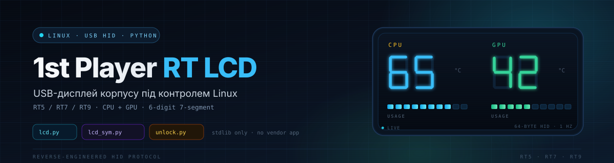
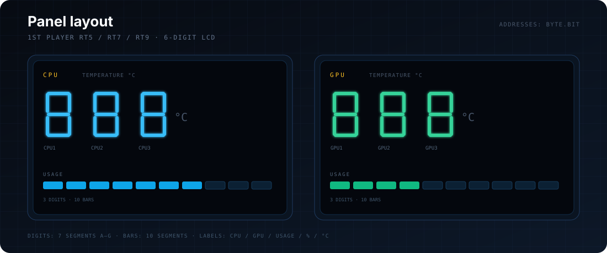

<p align="center">
  
</p>

<h1 align="center">1st Player RT LCD</h1>

<p align="center">
  <b>Linux control for the built-in USB LCD display of 1st Player RT5 / RT7 / RT9 cases.</b><br>
  CPU/GPU telemetry, a scrolling marquee and a panel stress test — pure Python, no vendor app.
</p>

<p align="center">
  
  
  
  
  
</p>

<p align="center">
  <a href="#quick-start">Quick start</a> ·
  <a href="#hidraw-auto-detection">Auto-detection</a> ·
  <a href="#systemd-service">systemd</a> ·
  <a href="#scripts">Scripts</a> ·
  <a href="#frame-format">Frame format</a> ·
  <a href="#segment-map">Segment map</a> ·
  <a href="README.md">Українська</a>
</p>

---

> [!NOTE]
> This is an unofficial community project. It is not affiliated with 1st Player and contains no vendor code or binaries. Use it at your own risk.

## Overview

| | |
|---|---|
| **Case** | 1st Player RT5 / RT7 / RT9 with a built-in 6-digit 7-segment LCD |
| **Interface** | USB HID, 64-byte output reports, `/dev/hidraw*` |
| **OS** | Linux (`hidraw`, `sysfs`, `hwmon`) |
| **Dependencies** | Python 3.8+ standard library only |
| **Test unit** | `5131:2007`, exposed as `/dev/hidraw3` on the test machine |
| **Auto-detection** | `/dev/1stplayer-rt-lcd` symlink → USB ID `5131:2007` scan |

> [!NOTE]
> On the test machine `lsusb` labels this device as `MSR MSR-101U Mini HID magnetic card reader` — that is just a VID/PID match in the `usb.ids` database. Look for the `hidraw` node that appears when the case display is connected and for 64-byte HID reports.

The panel has six 7-segment digits (three for CPU, three for GPU), two 10-segment bars and status labels such as `CPU`, `GPU`, `USAGE`, `%` and `°C`. These scripts implement the most useful mode: live CPU/GPU temperature and load.

## Quick start

```bash
git clone https://github.com/TaZ1kS/1stplayer-rt-lcd.git
cd 1stplayer-rt-lcd

# Install the udev rule + systemd service (recommended)
sudo ./install.sh

# Check that the service is running
systemctl status 1stplayer-rt-lcd.service
journalctl -u 1stplayer-rt-lcd.service -f
```

The installer copies the code to `/opt/1stplayer-rt-lcd`, creates a stable `/dev/1stplayer-rt-lcd` symlink via udev and starts the telemetry service. If the symlink has not appeared yet, replug the display's USB cable.

To run manually without a service:

```bash
sudo ./install.sh --no-service
python3 scripts/lcd.py                 # auto-detect the display
python3 scripts/lcd.py /dev/hidraw5    # explicit hidraw node
```

The scripts auto-detect the display: first the stable `/dev/1stplayer-rt-lcd` symlink, then a `hidraw` node with USB ID `5131:2007`. An explicit path argument always wins. If there is no match or more than one, the script lists the available `hidraw` devices and exits — it never picks a random device.

With multiple hidraw devices, find the right one first:

```bash
ls -l /dev/hidraw* /dev/1stplayer-rt-lcd
```

Or use the Makefile:

```bash
make monitor              # python3 scripts/lcd.py /dev/1stplayer-rt-lcd
make marquee              # python3 scripts/lcd_sym.py /dev/1stplayer-rt-lcd
make stress               # python3 scripts/unlock.py /dev/1stplayer-rt-lcd
```

## hidraw auto-detection

Device selection order:

1. **Explicit argument** — `python3 scripts/lcd.py /dev/hidraw5` always wins.
2. **Stable symlink** `/dev/1stplayer-rt-lcd`, created by the udev rule.
3. **USB ID scan** — the script reads `HID_ID` from `/sys/class/hidraw/hidraw*/device/uevent` and looks for `0003:00005131:00002007`.

If exactly one device matches, it is used. If there are no matches or several, the script lists the available `hidraw` devices and exits. This is intentional: it is better to fail than to send 64-byte frames to a keyboard, mouse or another HID device.

Check the IDs manually:

```bash
udevadm info -q property -n /dev/hidraw3 | grep -E 'ID_VENDOR_ID|ID_MODEL_ID'
cat /sys/class/hidraw/hidraw3/device/uevent | grep HID_ID
```

If your revision uses a different VID/PID, change `USB_VID`/`USB_PID` in the three scripts or pass the path explicitly. For the udev rule, change `idVendor`/`idProduct` in `udev/99-1stplayer-rt-lcd.rules`.

## systemd service

The service keeps `scripts/lcd.py` running in the background, restarts it on failure and starts it at boot. It uses the stable `/dev/1stplayer-rt-lcd` symlink instead of a hard-coded `/dev/hidrawN`.

### Install

```bash
sudo ./install.sh
```

The installer:

1. copies the scripts and docs to `/opt/1stplayer-rt-lcd`;
2. installs `/etc/udev/rules.d/99-1stplayer-rt-lcd.rules` with the symlink and `uaccess`;
3. installs `1stplayer-rt-lcd.service`;
4. enables and starts the service.

The service starts with `multi-user.target` and is not ordered after a `.device` unit for the symlink. `lcd.py --wait` waits up to 120 seconds for `/dev/1stplayer-rt-lcd`, so a slow USB display does not delay boot by 90 seconds or leave the panel blank. If the display does not appear, the service exits with an error and retries; `Restart=always` and `StartLimitIntervalSec=0` keep systemd trying.

Check it:

```bash
systemctl status 1stplayer-rt-lcd.service
journalctl -u 1stplayer-rt-lcd.service -f
ls -l /dev/1stplayer-rt-lcd
```

Manage it:

```bash
sudo systemctl restart 1stplayer-rt-lcd.service
sudo systemctl stop 1stplayer-rt-lcd.service
sudo systemctl disable --now 1stplayer-rt-lcd.service
```

The same via `make`:

| Command | Action |
|---|---|
| `make install` | install the service and udev rule |
| `make status` | show service status |
| `make logs` | follow the journal |
| `make uninstall` | remove the service |

### Without a service

```bash
sudo ./install.sh --no-service
python3 /opt/1stplayer-rt-lcd/scripts/lcd.py /dev/1stplayer-rt-lcd
```

### User service

To run telemetry inside your desktop session instead, install the files without the system unit and then enable the user service:

```bash
sudo ./install.sh --no-service
make install-user-service
systemctl --user status 1stplayer-rt-lcd.service
journalctl --user -u 1stplayer-rt-lcd.service -f
```

This works thanks to `TAG+="uaccess"` in the udev rule — no root required. The user service starts after graphical login, not at boot.

### Update and remove

```bash
git pull
sudo ./install.sh          # reinstall files and restart the service

sudo ./uninstall.sh        # remove the service, udev rule and /opt files
```

For the user service:

```bash
systemctl --user disable --now 1stplayer-rt-lcd.service
rm -f ~/.config/systemd/user/1stplayer-rt-lcd.service
systemctl --user daemon-reload
```

> [!NOTE]
> If `/dev/1stplayer-rt-lcd` does not appear, check the VID/PID in the udev rule, run `sudo udevadm control --reload-rules && sudo udevadm trigger`, and replug the display. The scripts can also find the device by USB ID without the symlink, but the service uses `/dev/1stplayer-rt-lcd` explicitly so it does not depend on the `hidrawN` ordering.
>
> If the service takes a long time to start after a reboot, check `systemctl cat 1stplayer-rt-lcd.service`: versions before v1.1.1 contained `After=`/`Wants=` for `dev-1stplayer\x2drt\x2dlcd.device`. When the symlink device unit failed to activate, systemd waited for the 90-second timeout. Update with `git pull && sudo ./install.sh`.

## Scripts

| Script | What it does | Refresh |
|---|---|---|
| [`lcd.py`](scripts/lcd.py) | Live CPU/GPU temperatures on the digits, load on the bars | 1 Hz |
| [`lcd_sym.py`](scripts/lcd_sym.py) | Scrolling text on the six digits; Latin, Cyrillic and digits | 0.25 s per step |
| [`unlock.py`](scripts/unlock.py) | All-segments stress test at a configurable refresh rate | 1–200 Hz |

### `lcd.py`

```bash
python3 scripts/lcd.py
```

For systemd there is a wait mode: `python3 scripts/lcd.py --wait /dev/1stplayer-rt-lcd`. It waits up to 120 seconds for the node to appear; the unit file uses this mode.

Sensor discovery:

| Metric | Source |
|---|---|
| CPU temperature | `hwmon` named `coretemp`, `k10temp`, `zenpower` or `cpu_thermal`, `temp1_input` |
| CPU load | `/proc/stat`, idle/total delta |
| GPU temperature | `hwmon` under `/sys/class/drm/card*/device/`, `temp1_input` |
| GPU load | `/sys/class/drm/card*/device/gpu_busy_percent` (AMD) |

Temperatures use three digits; load uses a 10-segment bar (~10% per segment). Missing sensors fall back to `0`. `gpu_busy_percent` is AMD-specific; NVIDIA load is not supported by this script.

Sensors are re-checked at runtime. If the service started before `amdgpu` registered its `hwmon` or `gpu_busy_percent` node, the GPU values appear without restarting the service. The same retry recovers a sensor path that became stale after a GPU reset.

#### Startup and shutdown animation

On start, `lcd.py` first plays a short greeting: the six digits fill clockwise one by one (segments `A`→`F`, then the centre `G`), the load bars grow left to right, all labels light up, the panel blinks once, and telemetry begins. On stop (`SIGTERM` from systemd or `Ctrl+C`) the circle runs in reverse, blinks and fades the panel out.

The animation only touches bits 40–52; service bytes 24–39 stay zero. To skip it:

```bash
python3 scripts/lcd.py --no-anim /dev/1stplayer-rt-lcd
```

With `--no-anim` the panel is simply cleared on exit.

### `lcd_sym.py`

```bash
python3 scripts/lcd_sym.py
```

Type text and press Enter; an empty line is ignored and `q` quits. A six-character window scrolls with a 0.25 s step, padded with six spaces at both ends.

Supported characters: digits `0–9`, space, `-`, `_`; Latin `a b c d e f g h i j l n o p r s t u y z`; Cyrillic `а б в г д е є з и і ї к л м н о п р с т у ч ш ь`. Unsupported characters are rendered as blanks. The font is a dictionary in `lcd_sym.py` and can be extended.

### `unlock.py`

```bash
python3 scripts/unlock.py
```

Alternates all-on/all-off frames. Enter a target frequency in Hz (`2`, `10`, `60`, `120`, …); the status line shows the target and actual FPS. `q` or `Ctrl+C` exits and clears the panel.

> [!WARNING]
> The all-on frame writes `0xFF` to bytes 24–53, including service bits. The screen may flicker, blank or behave oddly — that is expected for a stress test. Do not use this as a normal display mode.

## Frame format

One frame is exactly 64 bytes, written to the hidraw node in a single `write()`. There is no ACK.

| Byte | Value | Purpose |
|---:|---|---|
| 0 | `seq` | Counter: starts at `0x61`, then `+1 & 0xFF` |
| 1 | `0x00` | Fixed header |
| 2 | `0x02` | Fixed header |
| 3–23 | `0x00` | Reserved |
| 24–39 | `0x00`* | Service/static icons |
| 40–52 | bitmap | Digits, bars and labels |
| 53–63 | `0x00` | Reserved |

\* Vendor frames contain a baseline icon state here; `lcd.py` and `lcd_sym.py` write zeros, while `unlock.py` writes `0xFF`.

Bits are zero-indexed: `0x01` is bit 0, `0x80` is bit 7. To light segment `A` of the first CPU digit, set bit 0 of byte 40. A blank frame is `61 00 02` followed by 61 zeros. The all-on frame is `61 00 02`, 21 zeros, 30 bytes of `FF` (bytes 24–53) and 10 zeros.

See [`docs/PROTOCOL.md`](docs/PROTOCOL.md) for the full breakdown.

## Segment map

<p align="center">
  
</p>

Addresses are written as `byte.bit`.

| Digit | A | B | C | D | E | F | G |
|---|---|---|---|---|---|---|---|
| **CPU1** | 40.0 | 42.0 | 52.0 | 50.0 | 48.0 | 44.0 | 46.0 |
| **CPU2** | 52.1 | 44.1 | 42.1 | 46.1 | 40.1 | 50.1 | 48.1 |
| **CPU3** | 42.2 | 50.2 | 44.2 | 52.2 | 48.2 | 40.2 | 46.2 |
| **GPU1** | 50.3 | 40.3 | 46.3 | 48.3 | 44.3 | 52.3 | 42.3 |
| **GPU2** | 44.4 | 42.4 | 52.4 | 48.4 | 50.4 | 40.4 | 46.4 |
| **GPU3** | 48.5 | 50.5 | 42.5 | 44.5 | 40.5 | 52.5 | 46.5 |

CPU2 splits `D` and `G`: `D = 46.1`, `G = 46.2`.

| Bar | 1 | 2 | 3 | 4 | 5 | 6 | 7 | 8 | 9 | 10 |
|---|---|---|---|---|---|---|---|---|---|---|
| **CPU** | 46.6 | 48.6 | 50.6 | 52.6 | 41.0 | 45.0 | 43.0 | 42.6 | 44.6 | 40.6 |
| **GPU** | 49.0 | 51.0 | 40.7 | 42.7 | 44.7 | 47.0 | 52.7 | 50.7 | 48.7 | 46.7 |

Labels: `CPU` = 41.2, `GPU` = 51.2, `CPU %` = 41.1, `GPU %` = 51.1, `CPU °C` = 45.1, `GPU °C` = 47.1, `CPU USAGE` = 43.2, `GPU USAGE` = 47.2.

Full byte/bit table: [`docs/SEGMENT_MAP.md`](docs/SEGMENT_MAP.md).

## Compatibility

| Component | Status |
|---|---|
| Linux + hidraw | ✅ |
| Windows | ❌ — use [1ST PC Monitoring](https://1stplayer.com/download/) |
| Intel CPU temperature | ✅ `coretemp` |
| AMD CPU temperature | ✅ `k10temp` / `zenpower` |
| AMD GPU temperature + load | ✅ `amdgpu` |
| NVIDIA GPU load | ❌ `gpu_busy_percent` is not used |
| NVIDIA GPU temperature | ⚠️ only if the driver exposes `temp1_input` |
| Other cases with a similar LCD | ⚠️ segment map may differ |

## Safety

The scripts write to the selected hidraw node. Make sure it is the display, not a keyboard, mouse or card reader — especially with `unlock.py`, which sends `0xFF` to bytes 24–53. Check `lsusb`, `udevadm info` and `ls -l /dev/hidraw*` before running anything. This project is not affiliated with 1st Player; use it at your own risk.

## License

[MIT](LICENSE) © 2026 TaZ1kS

See [`CHANGELOG.md`](CHANGELOG.md) for release history.
